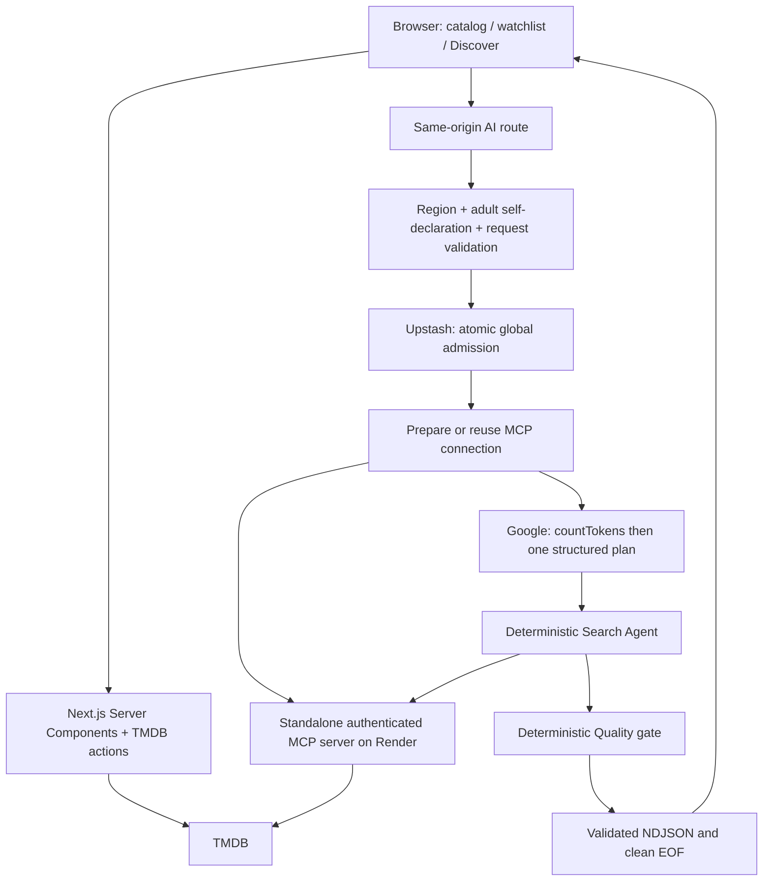

# Movie Explorer — implemented architecture

Updated 2026-11-02. This describes shipped source, not a certification of every provider term, deployment or performance budget. Execution status and retained limitations live in [the release checklist](docs/RELEASE_CHECKLIST.md); agent guardrails remain in [`.ai/ARCHITECTURE.md`](.ai/ARCHITECTURE.md).

## Runtime boundaries

The public movie catalog is worldwide. Its pages still use server-side TMDB actions: the five MCP tools do not cover popular movies, trailers and all existing pagination. Do not remove this layer until that coverage exists. No browser request goes directly to the TMDB **data** API; public poster/trailer hosts are expected.

## Application

| Boundary | Implementation |
|---|---|
| Layout / pages | `app/layout.tsx`, `/`, `/movie/[id]`, `/watchlist`, `/discover` |
| Catalog data | `src/server/actions/tmdb.ts`; server-only TMDB credentials |
| Saved movies | `src/context/WatchlistProvider.tsx`; browser-local storage with SSR-safe hydration |
| AI entry | `app/api/ai/search/route.ts` and `src/server/ai/search-handler.ts` |
| Activation | Server-owned `src/server/ai/availability.ts`; same switch supplies trusted Google configuration |
| Eligibility controls | AI-only region policy plus exact, versioned adult self-declaration header; checked before body/admission |
| Shared admission | Atomic Redis script; one admission/60s, ten/rolling 24h globally; no visitor identifiers |
| Orchestration | `src/server/agents/orchestrator.ts`; preparation → Planner → Search → Quality |
| Public presentation | `src/lib/ai/`; strict schemas, controlled stage/error codes, escaped React text |
| Telemetry | Process-local fixed-cardinality aggregates; protected read-only `/api/telemetry/tokens` |
| Styling | `shared/tokens` → layout theme/Tailwind/AI theme; self-hosted fonts, reduced-motion guards |
| Mobile demo | Same-origin production QR; encoder chunk deferred until its reserved placeholder approaches the viewport |
| Route failure | App Router `app/error.tsx` with branded reset/catalog actions, not raw exception text |
| Trailer | Client leaf; native load button and external link, privacy-enhanced YouTube iframe only on visitor intent |

An adult declaration is user-controlled and ephemeral, **not verified age, authentication or proof of provider-policy eligibility**. The deployed country-header spoof check found no decision change for caller-supplied restricted/allowed/unknown values at one network vantage; it does not establish geolocation accuracy or every ingress path. Neither control replaces the global quota. See [`AI_GEO_CHECK.md`](docs/AI_GEO_CHECK.md).

## Standalone MCP

`packages/mcp-server` is an independently built/deployed Node application, not embedded in Next.js. Its sole transport is Streamable HTTP at `/mcp`; it exposes `/health` and `/ready` and requires server-to-server Bearer authentication. Origin checks, schemas and redirect rejection protect the boundary. The five tools are movie search, details, credits, recommendations and trending. Browser code must never import this runtime or receive its credentials.

Next.js calls it only through `src/server/mcp`. The process-local connection singleton shares initialization and clears failed/disconnected clients; it retains no movie/model result cache. Canceling one waiter does not destroy other callers' shared initialization.

## AI budgets and data handling

- Fixed approved model: `gemini-3.1-flash-lite`. No alternate model, automatic retries, repair generation or paid fallback.
- Prepare MCP only after admission, **before** Google token counting/generation, so unavailable startup does not transmit the prompt to Google. Preparation calls no movie tool.
- At most one exact-wire `countTokens`, then one generation; **both transmit input**. Google receives static instructions/schema and the submitted message/optional selected movie ID, not local watchlist, files or browsing history.
- 4,096 input / 512 output / 4,608 total model tokens; at most five reserved tool calls; plan validation precedes tool execution.
- Initialization 20s, pipeline 30s, route/UI 35s, individual tool 10s. Preparation shares the total deadline. Failed/cancelled admitted attempts consume quota; no refunds, resets or local fallback.
- Quality is deterministic and evidence-derived. Never expose raw model text, thoughts, tool envelopes, prompts, exception messages or unvalidated Markdown/HTML.
- Browser reader requires ordered `preparing → planning → searching → validating`, a single terminal, valid UTF-8, bounded bytes and clean EOF before presentation.
- No prompt/evidence/result cache. Redis holds at most ten admission timestamps; telemetry holds only aggregate usage/latency counters and is not durable billing reconciliation.

## Build and deployment

Next.js deploys on Vercel; MCP deploys separately on Render Free. `npm run build` creates the standalone output and assembles static assets plus optional public files. `npm start` and Docker consume that same assembled output. No private environment file is copied by the assembly helper; nested dependency/build/env artifacts are excluded from Docker context.

CI covers application/MCP checks, isolated **local** Redis, production assembly, a scoped browser-bundle boundary check, browser accessibility, Lighthouse budgets and Docker build. Provider keys stay server-side. Environment setup, historical evidence and rollback: [deployment](docs/DEPLOYMENT.md), [AI release](docs/AI_RELEASE.md), [operations](docs/AI_OPERATIONS.md).

One earlier separately authorized real local inference passed. That permission was consumed; do not interpret documentation work, UI review or a ten-request **mocked telemetry test** as authorization for new live inference. No release tag or complete-phase archive should imply the outstanding checks have passed.
